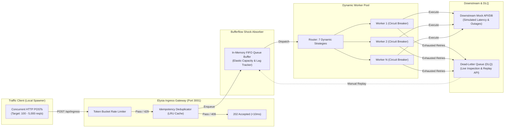

# Bufferflow

> **High-Throughput Ingress Gateway & Shock Absorber Buffer Engine**  
> Sub-10ms Ingress • In-Memory Queue Buffer • Circuit Breaking Worker Pool • DLQ Replay • Live 250ms WebSockets Telemetry

Bufferflow protects downstream microservices and databases from catastrophic failure during high-volume traffic bursts. It acts as an elastic shock absorber by accepting incoming requests in `<10ms`, performing fast token-bucket rate limiting and idempotency deduplication, buffering payloads in memory, and dispatching tasks to downstream workers using dynamic routing strategies (Least Connections, Weighted Round-Robin, Power of Two Choices, Weighted Least Connections, Random, Consistent Hashing) with automated circuit breakers, Dead-Letter Queue (DLQ), and instant JSON telemetry export.

---

## Key Architecture & Features



- **Sub-10ms Ingress SLA**: Evaluates rate-limiting rules and checks payload deduplication keys (`Idempotency-Key`), instantly returning `202 Accepted` to release the client connection.
- **In-Memory Shock Absorber**: Absorbs high-concurrency bursts (up to 50,000+ queue capacity) and shields downstream services from resource exhaustion.
- **Dynamic Routing Policies**:
  - **Least Connections**: Dynamically assigns jobs to the worker with the lowest active in-flight count.
  - **Weighted Round-Robin**: Balances tasks according to worker weight tiers.
  - **Standard Round-Robin**: Cyclic uniform task distribution.
  - **Power of Two Choices (P2C)**: Selects two random workers and routes to the one with lower load.
  - **Weighted Least Connections**: Balances active connections normalized by worker weight capacity.
  - **Random Selection**: Uniform randomized worker assignment.
  - **Consistent Hashing**: Deterministically routes by payload idempotency key for session affinity.
- **Live Ops Control Synchronization**: Runtime parameter adjustments (RPS, worker pool size, error rate, downstream latency, collision rate, routing algorithm) take effect immediately during active traffic runs.
- **Unlimited Duration Mode & Safety Fallbacks**: Support for continuous load runs with automated safety safeguards that halt traffic if the browser window or tab loses focus, becomes hidden, or closes.
- **Results Export & Copy Console**: Automated modal summary popup after run conclusion with one-click JSON copy and file download.
- **Circuit Breaker State Machine**:
  - `CLOSED`: Normal operation.
  - `OPEN`: Trips after consecutive downstream failures exceed threshold, halting traffic to the impaired worker.
  - `HALF_OPEN`: Periodically admits canary requests to verify downstream recovery.
- **Dead-Letter Queue (DLQ)**: Failed tasks exhausting retries are captured with root-cause error reasons and can be replayed back into the active buffer individually or in bulk.
- **Real-Time Telemetry & WebSocket Broadcast (250ms busy / 1s idle)**:
  - Incoming RPS, Accepted RPS, Rate-Limited RPS, Drained RPS.
  - Ingress Gateway Latency (P50, P95, P99).
  - Buffer Depth, Utilization %, Queue Lag (ms).
  - Worker node statuses and circuit breaker indicators.
- **Antigravity Glassmorphic Dashboard**: Sleek cyberpunk dark UI with an interactive Canvas DAG particle stream, live rolling charts, runtime parameter controls, and randomized load presets.

---

## Quickstart

### Prerequisites

- [Bun](https://bun.sh) (v1.2+) or Docker

### 1. Install Dependencies

```bash
bun install
```

### 2. Configure Environment (optional)

```bash
cp .env.example .env
# Adjust PostgreSQL settings; the app falls back to in-memory history
# automatically when no database is reachable.
```

### 3. Run Test Suite

```bash
bun test
```

### 4. Start Development Server

```bash
bun run dev
```

Open your browser to:

```
http://localhost:3001
```

---

## Docker Deployment

### Run with Docker Compose

```bash
docker compose up -d --build
```

View logs:

```bash
docker compose logs -f bufferflow
```

---

## API Reference

| Endpoint                     | Method           | Description                                                                                                                                                                                                                                                     |
| :--------------------------- | :--------------- | :-------------------------------------------------------------------------------------------------------------------------------------------------------------------------------------------------------------------------------------------------------------- |
| `/api/auth/status`           | `GET`            | Public auth discovery (`{ "required": boolean }`) used by the dashboard token gate.                                                                                                                                                                             |
| `/api/ingress`               | `POST`           | High-speed ingress gateway returning `202 Accepted` (<10ms). Accepts optional `Idempotency-Key` header. A `503` buffer-overflow response does **not** consume the idempotency key, so the request can be retried.                                               |
| `/api/traffic/start`         | `POST`           | Start the in-process concurrent traffic generator. Applies the requested failure rate, downstream latency, worker count and routing strategy before starting. Returns `409` while a server suite is running. Clears prior run history and cached suite results. |
| `/api/traffic/full-test`     | `POST`           | Start the server-managed multi-strategy benchmark suite (single level or all 4 levels). Returns `409` while another suite is running.                                                                                                                           |
| `/api/traffic/stop`          | `POST` / `GET`   | Halt active traffic and/or a running suite. Optional `reason` (`stopped_by_user`, `safety_fallback_blur`, `safety_fallback_unload`). Returns `suiteResults: null` when no suite was running.                                                                    |
| `/api/traffic/status`        | `GET`            | Traffic generator status, effective traffic config, suite progress and the last compiled suite result.                                                                                                                                                          |
| `/api/traffic/suite-results` | `GET`            | Last compiled full-suite result (or an error object when none exists).                                                                                                                                                                                          |
| `/api/dlq`                   | `GET`            | Paginated listing of dead-letter queue records (`limit` 1–500).                                                                                                                                                                                                 |
| `/api/dlq/replay`            | `POST`           | Replay single item (`{ "id": "..." }`) or all items back to the buffer. Replay stops if the buffer is full and keeps unreplayed records in the DLQ.                                                                                                             |
| `/api/dlq`                   | `DELETE`         | Purge dead-letter queue.                                                                                                                                                                                                                                        |
| `/api/config`                | `GET` / `POST`   | Inspect or dynamically reconfigure runtime cluster parameters (including `maxConcurrencyPerWorker`) live. Partial patches preserve unspecified fields. Locked during server suite runs.                                                                         |
| `/api/metrics`               | `GET`            | Snapshot of the latest telemetry frame (does not reset the 250ms scheduler window).                                                                                                                                                                             |
| `/api/metrics/reset`         | `POST`           | Reset cumulative counters, RPS windows, latency samples, worker counters and the buffer.                                                                                                                                                                        |
| `/api/history`               | `GET` / `POST`   | List or save historical runs. Manual runs are stored as `STANDARD`; automated suites as `FULL_SUITE`.                                                                                                                                                           |
| `/api/history/:id`           | `GET` / `DELETE` | Fetch or delete a historical run.                                                                                                                                                                                                                               |
| `/ws`                        | `WebSocket`      | Real-time telemetry broadcast (250ms while busy, 1s when idle; session-scoped via `?session=`).                                                                                                                                                                 |

When `BUFFERFLOW_API_TOKEN` is configured, every endpoint in this table except `/api/auth/status` (including `/api/ingress` and `/ws`) requires a matching bearer token.

### Telemetry Semantics

- `p50LatencyMs` / `p95LatencyMs` / `p99LatencyMs` measure **ingress gateway latency** (rate-limit + idempotency + enqueue path).
- Suite benchmarks use **processing latency** (enqueue → terminal success/DLQ) so benchmarks compare downstream strategy cost.
- `totalProcessed` / `totalFailed` / `drainedRps` count **terminal outcomes**, not retry attempts.
- Suite results are fetched on demand when a run completes; they are not re-sent in every telemetry frame.
- Between suite strategies, new traffic is stopped and accepted work is drained under the current strategy before the strategy switches; buffered events are **not** purged. Leftover work (only if the bounded drain times out) carries into the next strategy.
- When a suite finishes or is stopped, the pre-suite system config (latency, failure rate, worker count, routing strategy) is restored.

### Authentication & Request Limits

Control-plane auth is opt-in via `BUFFERFLOW_API_TOKEN`. When it is set, every `/api/*` endpoint and the `/ws` upgrade require a token supplied as:

- `Authorization: Bearer <token>`
- `X-API-Token: <token>`
- `?token=<token>` (WebSocket/beacon URLs)

`GET /api/auth/status` stays public so clients can discover whether a token is required. The dashboard shows a token gate when needed and stores the token in the browser's `localStorage`. Ingress callers must send the token too.

`BUFFERFLOW_MAX_BODY_BYTES` (default 1 MiB) is enforced by the Bun server and by a `Content-Length` check; larger API requests receive `413 Payload Too Large`.

### Backfilling Historical Run Types

Older versions stored manual burst runs as `FULL_SUITE` because the client omitted `test_type`. To correct historical rows that have no strategy breakdown:

```bash
bun run db:backfill:test-type --dry-run   # preview affected rows
bun run db:backfill:test-type             # apply UPDATE
```

The script updates `test_type = 'STANDARD'` only where `test_type = 'FULL_SUITE'` and both `strategy_breakdown` and `level_breakdowns` are `NULL`.

### Environment Variables

| Variable                                                                                  | Description                                                                                      |
| :---------------------------------------------------------------------------------------- | :----------------------------------------------------------------------------------------------- |
| `PORT`                                                                                    | HTTP/WS listen port (default `3001`).                                                            |
| `DATABASE_URL`                                                                            | Optional full PostgreSQL connection string; takes precedence over `POSTGRES_*`.                  |
| `POSTGRES_HOST` / `POSTGRES_PORT` / `POSTGRES_DB` / `POSTGRES_USER` / `POSTGRES_PASSWORD` | PostgreSQL connection when `DATABASE_URL` is not set.                                            |
| `RUN_MIGRATIONS`                                                                          | Set `true` to apply migrations on every development boot. Production applies them automatically. |
| `BUFFERFLOW_DISABLE_DB`                                                                   | Set `1` to force in-memory history storage (used by tests).                                      |
| `BUFFERFLOW_API_TOKEN`                                                                    | Optional shared bearer token protecting all API and WebSocket endpoints.                         |
| `BUFFERFLOW_MAX_BODY_BYTES`                                                               | Maximum request body size in bytes (default `1048576`, 1 MiB).                                   |
| `BUFFERFLOW_PORT`                                                                         | Host-side port used by `docker-compose.yml`.                                                     |

If PostgreSQL is unreachable the app logs a warning and keeps historical runs in memory; it retries the connection in the background rather than disabling persistence for the rest of the process lifetime.
